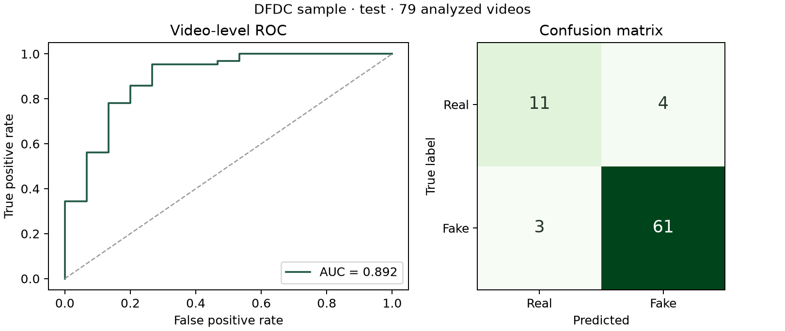

# First trained CPU baseline — 6 November 2026

**ResNet18 with a trained logistic regression head achieved 91.1% video accuracy, 84.3% balanced accuracy, and 0.892 AUC on 79 analyzable held-out DFDC sample videos.** Two additional test videos received insufficient evidence. This is a small visual-only research result, not evidence of banking deployment readiness.

The model was trained and evaluated on the laptop's CPU. No GPU, Colab, or Google Drive was used. The ImageNet encoder stayed frozen; only the regularized classifier was trained on DFDC labels.

## Data and fixed splits

The official labeled training sample contains 400 videos: 77 REAL and 323 FAKE. Its compressed ZIP is 1,868,756,561 bytes, approximately 1.87 GB. The workflow read one archived video at a time rather than keeping a second full extracted dataset.

Source-video references were grouped before splitting with seed 42. There are 244 source groups, including references to originals absent from the sample. Original-video grouping does not establish actor-disjoint splits.

| Split | Requested real / fake | Requested total | Analyzable real / fake | Analyzable total |
| --- | ---: | ---: | ---: | ---: |
| Training | 46 / 193 | 239 | 41 / 169 | 210 |
| Validation | 15 / 65 | 80 | 14 / 58 | 72 |
| Test | 16 / 65 | 81 | 15 / 64 | 79 |

Face preparation processed all 400 videos. Of these, 361 had at least four usable frames, 39 had insufficient evidence, and none failed to decode. The uniform 12-frame sampler, YuNet detector, 224-pixel crops, and multi-face rejection settings were fixed before training. A contact sheet of training crops was reviewed locally; test crops were not used for manual selection.

## Validation comparison and model choice

Each frozen encoder was compared using logistic classifier C values 0.01, 0.1, 1, and 10. Scaling and classifier fitting used training data only. Class weighting balanced videos rather than treating every frame as an independent video. Frame scores were averaged into one video score.

The model and threshold were selected using validation balanced accuracy, with validation AUC and then smaller C as tie breakers. No test metric was used to choose them.

| Encoder | Selected C | Validation accuracy | Validation balanced accuracy | Validation AUC | Threshold |
| --- | ---: | ---: | ---: | ---: | ---: |
| EfficientNet-B0 | 1.0 | 77.8% | 86.2% | 0.900 | 0.811064 |
| **ResNet18 — selected** | **1.0** | **87.5%** | **89.5%** | **0.910** | **0.663424** |

EfficientNet-B0 was the initial resource-conscious candidate, but ResNet18 performed better under the predefined validation rule, so the saved baseline uses ResNet18. This comparison does not establish a universal best architecture.

## Held-out test results

The selected model and validation threshold were frozen before test evaluation. Metrics describe the 79 analyzable videos out of 81 requested, giving 97.5% test analysis coverage.

| Metric | Result |
| --- | ---: |
| Correct classifications | 72 / 79 |
| Accuracy | 91.14% |
| Balanced accuracy | 84.32% |
| ROC AUC | 0.8917 |
| Fake precision | 93.85% |
| Fake recall | 95.31% |
| Fake F1 | 94.57% |
| Log loss | 0.3001 |
| Always-predict-FAKE reference accuracy | 81.01% |
| Always-predict-FAKE reference balanced accuracy | 50.00% |

| True label | Predicted REAL | Predicted FAKE |
| --- | ---: | ---: |
| REAL | 11 | 4 |
| FAKE | 3 | 61 |

The model missed **3 of 64 fakes** and falsely flagged **4 of 15 real videos**. The latter is a **26.7% observed false-positive rate on real clips**, which needs improvement before a banking application. The small real-video count also makes this estimate uncertain.

Source-group bootstrap intervals from 300 resamples were 70.0–95.4% for balanced accuracy and 0.777–0.982 for AUC. These wide intervals reinforce the need for a larger independent evaluation. The settings were not changed after observing these test results.

## Software checks and practical size

- All 18 pipeline tests passed, including group leakage prevention, validation-only selection, checkpoint export, held-out evaluation, crop-cache provenance, and sequential frame sampling.
- Actual saved-model inference on a training clip matched its cached-feature score within 0.00000018. This checks software consistency; it is not another accuracy experiment.
- A generated blank video correctly returned `insufficient_evidence` with no visual score.
- One cold prediction on a 10-second training clip took about 9.95 seconds, including loading and preprocessing. This single timing is not a general speed benchmark.
- Feature extraction took about 310 seconds for EfficientNet-B0 and 237 seconds for ResNet18 on this run; classifier fitting was much shorter.
- The selected checkpoint is approximately 44.8 MB. Generated data and experiment outputs use roughly 0.2 GB, in addition to the approximately 1.1 GB Python environment and 1.87 GB input ZIP.

The actual model is saved locally at `data/runs/cpu_baseline/model.pt`. It is excluded from Git, along with dataset clips and face crops. Run `PREDICT_VIDEO.cmd` from the project root to use the trained model. The React frontend still shows demo results until a backend connects it to this checkpoint.

## Reproduction and provenance

- Training code revision: `e1f4ae9ab283cf7ed40f9166998e9812c07df42c`.
- Model version: `visual-baseline-bb68915008`.
- Input ZIP SHA-256: `ffe0ca18e0d1342612e56cb3d55addb069c9e0e32781ef104c7c698b23a387c4`.
- Manifest fingerprint: `624683451d55ba3ce0c19506fa0a82851e1cb67bb60cfdccc1e0a4c39ac77bbd`.
- Checkpoint SHA-256: `5c08dc08484243fa8a773d9e9a02a34e6322d3972749e02c9650b841d4f22451`.
- Python 3.13.3; CPU PyTorch 2.15.0; TorchVision 0.29.2; OpenCV 4.14.0; scikit-learn 1.9.1. Exact settings and package versions are recorded in the [aggregate experiment JSON](dfdc_sample_cpu_2026-11-06.json).

See the [baseline guide](../README.md) for setup and commands. Retain this run as the CPU reference. Future fine-tuning should use training/validation data for decisions and preserve an independent final evaluation. DFDC clip labels can include voice-only manipulation, and this baseline analyzes faces only. Neither this result nor its score establishes identity or a calibrated probability of fraud.
